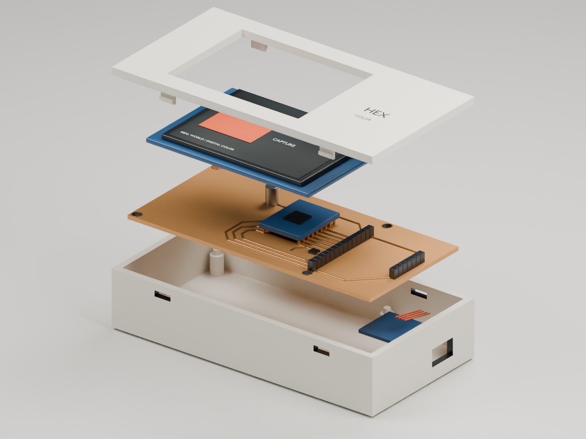
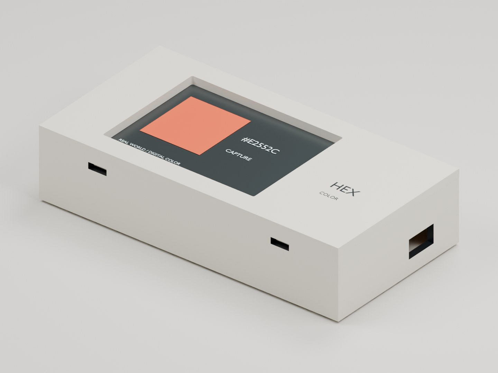
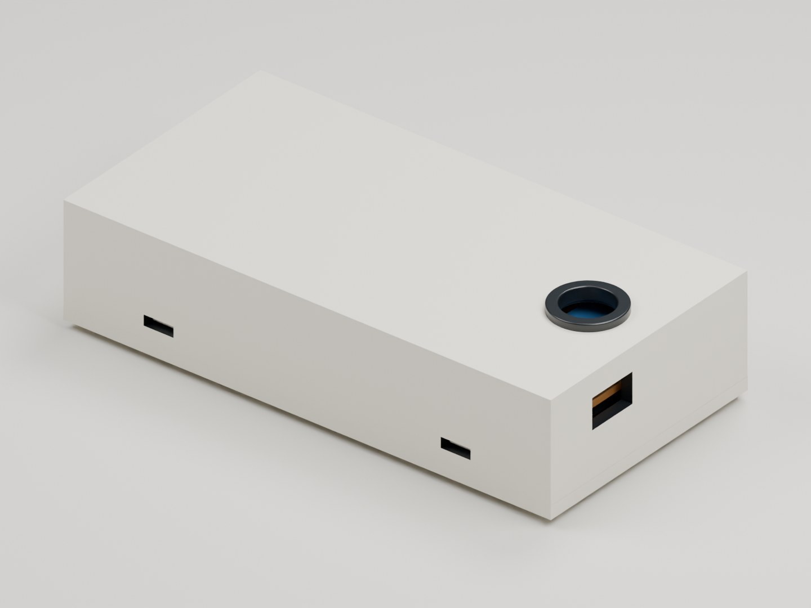

# HEX Color Board

A small board that turns real-world colors into HEX codes and back, made as a gift for a graphic-designer friend.



Designers work with colors as HEX codes (like `#E2552C`). The board offers three ways to go between a color and its code: pick a color from the on-screen spectrum and read its code, type a code and see the color, or point the color sensor on the back at anything around you and capture it.

An ESP32-S3-Zero runs the interface on a 2.8-inch SPI touch display. A TCS34725 RGB sensor on the back, read over I²C, has its own white LED for consistent lighting, and a small MOSFET switches the display backlight. The board was made in-house on an LPKF laser PCB machine from the files in `hardware/fabrication/`.


I also designed a case for it in Blender. The board sits on printed pins that pass through its four existing mounting holes, the lid snaps onto the lower tray without screws, the display shows through the front, and a ring on the back gives the color sensor its own shielded window. The module sizes in the model are estimates, so the case still needs a test print before it is final.

| Assembled | Back, with the sensor window |
|---|---|
|  |  |

## Files

```
hardware/                 KiCad project (open hex_display.kicad_pro)
hardware/fabrication/     Gerber and drill files
mechanical/               Blender case model and printable STL shells
docs/images/              renders and schematic
```

The board has been made; photos of the finished board will be added.

---

Yaşar Aykut Altuntop · Koç University · [LinkedIn](https://linkedin.com/in/aykutaltuntop) · [GitHub](https://github.com/Aykut0)
