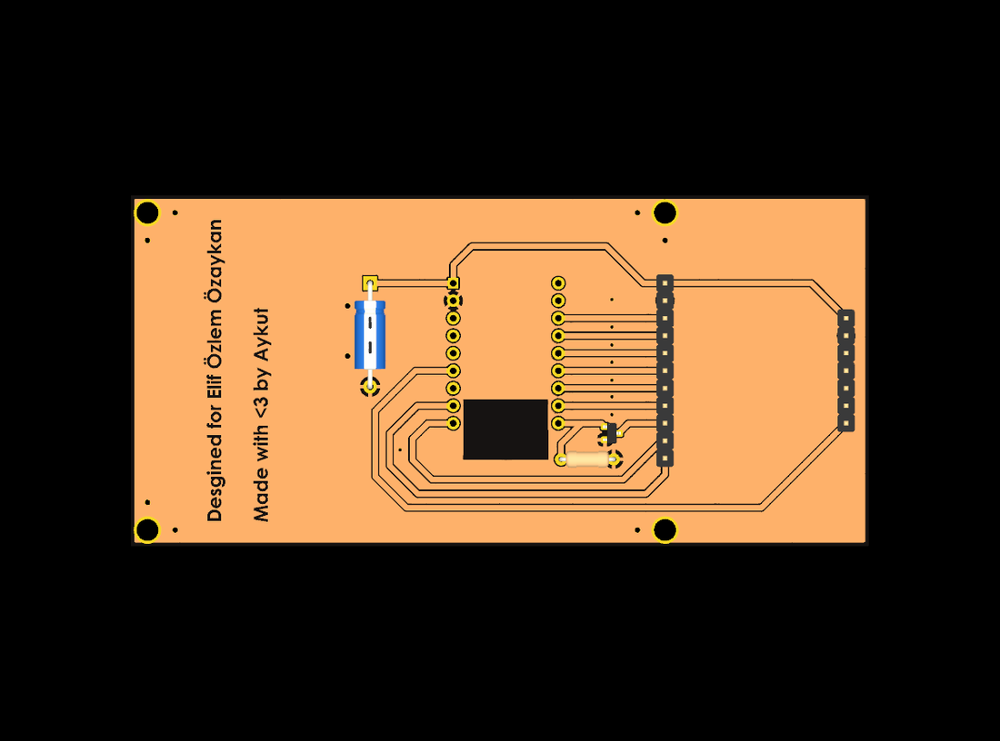
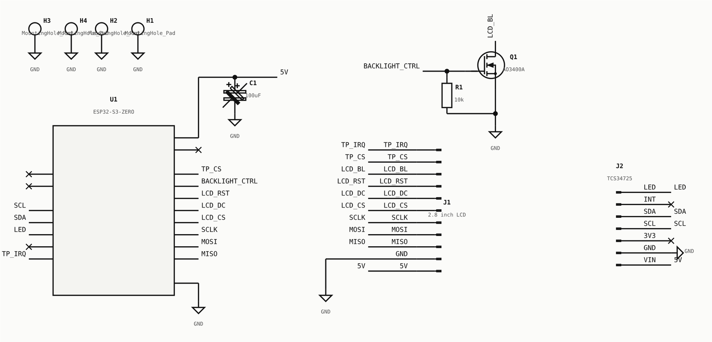

# HEX Color Board

A small board that turns real-world colors into HEX codes and back, made as a gift for a graphic-designer friend.



Designers work with colors as HEX codes (like `#E2552C`). The board offers three ways to go between a color and its code: pick a color from the on-screen spectrum and read its code, type a code and see the color, or point the color sensor on the back at anything around you and capture it.

An ESP32-S3-Zero runs the interface on a 2.8-inch SPI touch display. A TCS34725 RGB sensor on the back, read over I²C, has its own white LED for consistent lighting, and a small MOSFET switches the display backlight. The board was made in-house on an LPKF laser PCB machine from the files in `hardware/fabrication/`.



## Files

```
hardware/                 KiCad project (open hex_display.kicad_pro)
hardware/fabrication/     Gerber and drill files
docs/images/              render and schematic
```

Built and working. Photos of the finished board will be added.

---

Yaşar Aykut Altuntop · Koç University · [LinkedIn](https://linkedin.com/in/aykutaltuntop) · [GitHub](https://github.com/Aykut0)
